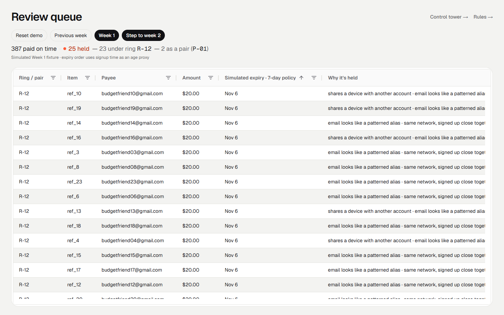
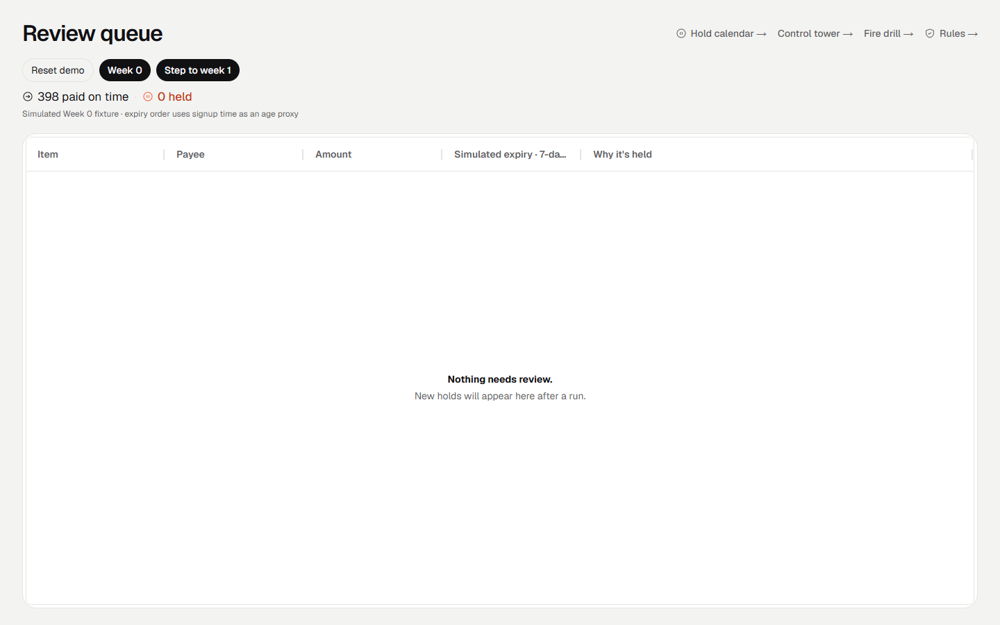
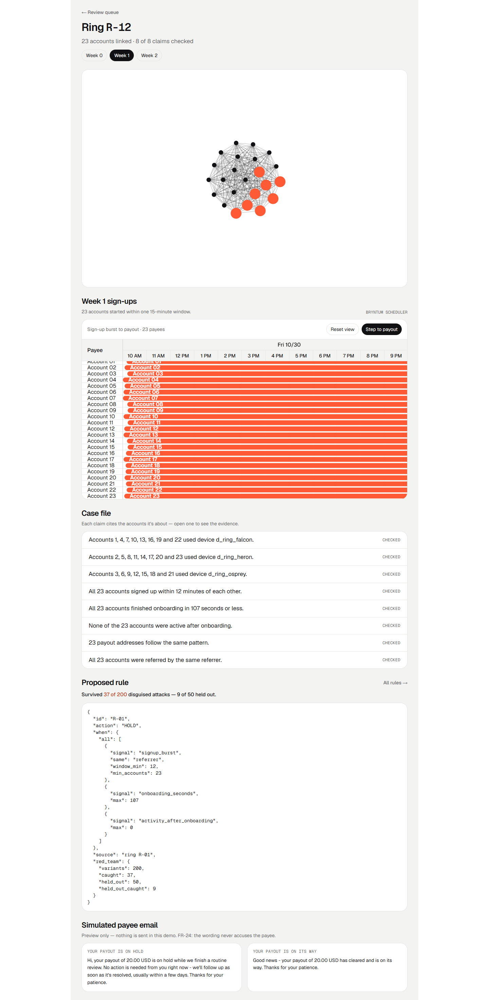
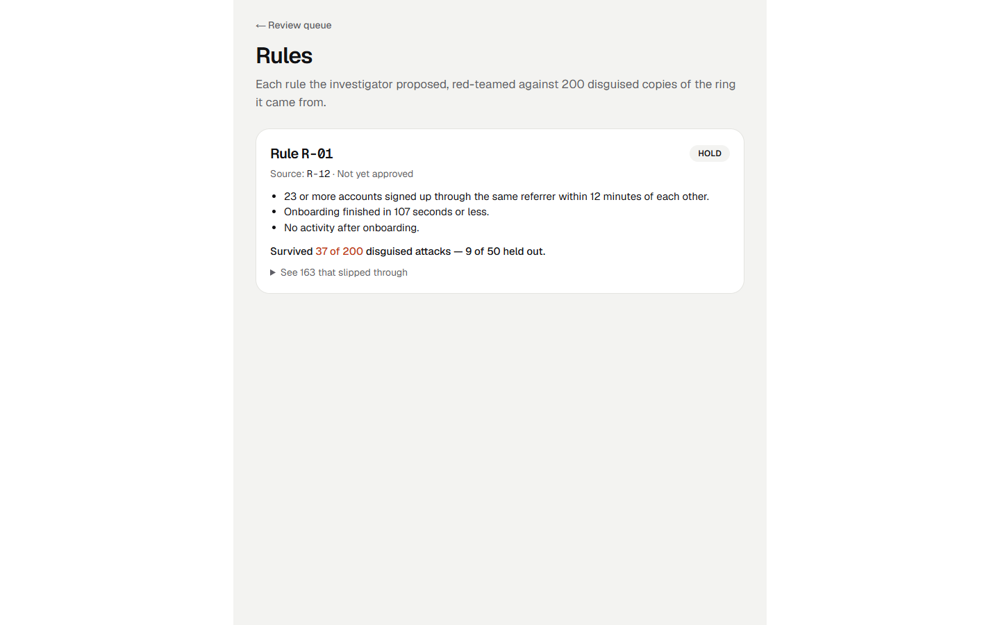
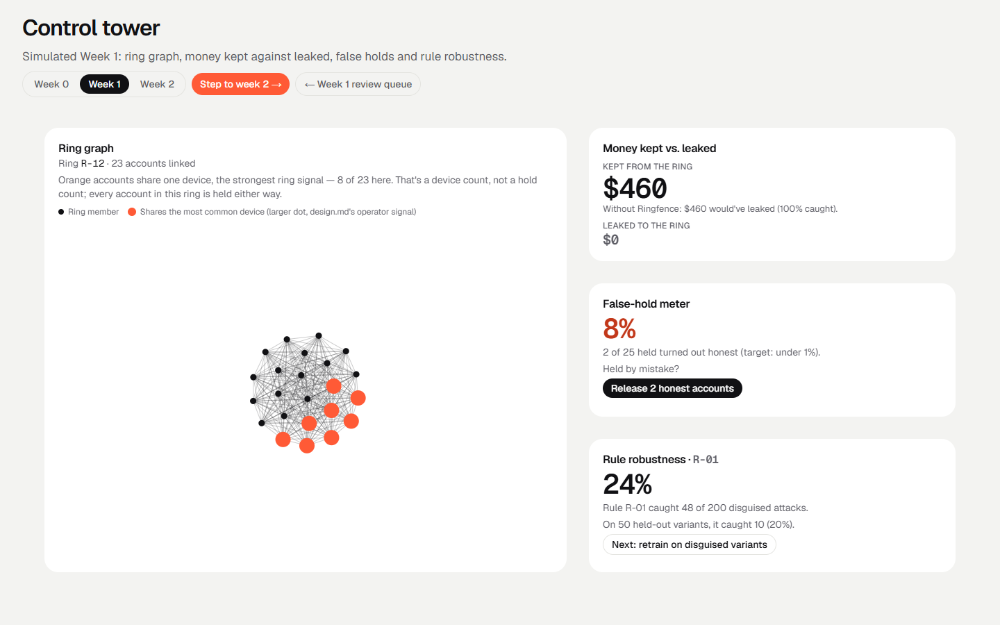
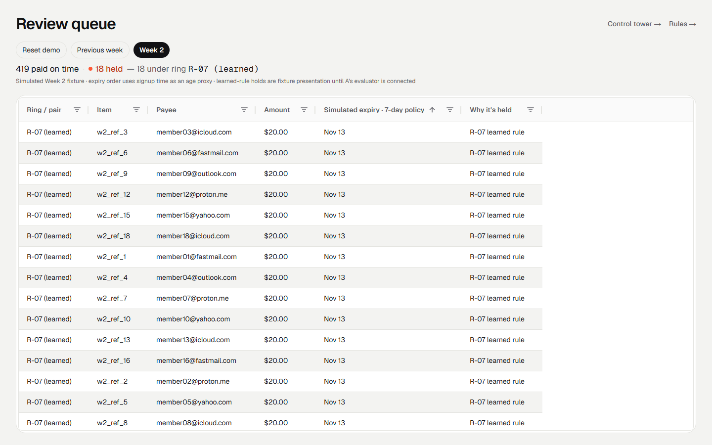

# Ringfence

*Pay the real ones. Hold the ring.*

Ringfence is a prototype built for the **2026 PayPal AI Hackathon**. It helps a payout team spot coordinated groups of fraudulent payees, review the evidence, and keep legitimate recipients moving.

The current demo uses seeded, simulated payout data. Week 2's learned-rule holds are illustrative fixture results while the backend evaluator is being integrated.

_Temporary project overview; fuller setup and demo instructions will be added as the build is finalized._

## How this was built

Built during the hackathon's submission period from a PRD (Ringfence v5, 3 Nov 2026) covering scope, requirements and demo data. Two engineers split the work: one on PayPal plumbing, the rule engine, and the Render deploy; the other, Claude-assisted, on the detection engine, demo data, the console, and the agents (investigator, claim checker, red-team agent).

### Review queue

387 members were paid on time. 25 payouts are on hold — 23 of them one ring, 2 a roommate pair. Every held item says why.



Reset demo (Week 0) starts clean with nothing held; Step to week N replays the next week's data.



### Ring detail

Opening a held item shows the graph that ties the ring together, a Bryntum timeline of all 23 sign-ups inside their 15-minute burst, the case file (every claim re-checked against the real data, not just asserted), and the rule the investigator proposed from this ring, with its red-team score.



### Rules

Every proposed rule is attacked with 200 disguised copies of the ring it came from before anyone sees it: Rule R-01 caught 48. The misses it didn't catch are saved as open red-team cases — the next time a rule is revised, it widens whichever check a majority of its own saved cases beat, and a direct replay (not just the revision's own fresh score) is what actually closes them: R-01-v2's wider signup window closes 13 of 112.



### Control tower

Six widgets built on the AG Studio dashboard engine: the ring graph, money kept vs. leaked, a false-hold meter, rule robustness, a Ring Watch panel, and an analyst read.



Week 2 shows what a learned rule would hold — labeled simulated, since the real rule evaluator is A's and not yet connected.

Ring Watch polls the live API every eight seconds for the ring's current member states. To see it update, open the same run's ring in another tab and confirm or release the hold. Set `RINGFENCE_API_URL`, the read-only `RINGFENCE_MCP_KEY`, and the server-side `RINGFENCE_RING_WATCH_THRESHOLD_USD` on the console host.

### Survey app

The `/survey-app` page submits a fresh 120-payee fixture to the API's `surveyapp` program on each run. Six payees reuse the confirmed Budgeting app ring R-12 device fingerprint; with the API's cross-program network configured, the expected result is 114 paid and 6 held with `network_match` reasons. Configure `RINGFENCE_SURVEY_API_KEY` on the console host to match the API's survey program key.



## How we used each sponsor's tool

Every sponsor component keeps the ink/mist/coral theme (design.md), not its stock look.

**AG Grid + AG Studio** — `apps/console/app/review/data-grid.tsx` groups the review queue by hold group, so one decision clears 23 payees at once (review-queue screenshot above). `apps/console/app/control-tower/control-tower.tsx` and `apps/console/app/control-tower/studio/widgets.tsx` provide six widgets; Ring Watch is the only one that polls live API state, while the analyst read uses checked case-file evidence.

**Bryntum Scheduler** — `apps/console/app/review/[ringId]/ring-timeline.tsx` is the ring timeline: one row per account, sign-up to payout, so a 23-account ring's 15-minute burst is visible at a glance (ring-detail screenshot above). `apps/console/app/review/calendar/hold-calendar.tsx` is the hold calendar: one row per held group, with 7-day hold limits and 30-day cancel countdowns.

**Render** — `render.yaml` is the one Blueprint: the API (with the worker's outbox-and-polling loop running inline, `apps/api/src/loop.ts`), the hourly cron (`apps/api/src/cron.ts`) and Postgres. Hosting only, not a UI feature — but genuinely deployed and exercised, not just configured: [docs/smoke-test-results.md](docs/smoke-test-results.md) records a real PayPal webhook arriving at and verified by the deployed instance, which only works against a real public URL.

**APIMatic** — [docs/openapi.yaml](docs/openapi.yaml), Ringfence's own OpenAPI spec, fed into the APIMatic CLI to generate [packages/sdk](packages/sdk): a real TypeScript client (`ringfence-api`, 94 files — auth, pagination, retries, error handling, one model per schema) and a Context Plugin (`packages/sdk/context-plugin`) that teaches a coding agent to use it, in TypeScript, C# and Python, installable in Claude Code, Cursor or Codex. Verified, not just generated: `npm install`, `typecheck`, `lint` and the SDK's own smoke test all pass clean in `packages/sdk`, 0 vulnerabilities. APIMatic's PayPal-side Context Plugin (the other half of this sponsor's brief) was evaluated and found not to cover Payouts — the one PayPal product this build uses — so that angle was dropped; this is the real deliverable instead.

## Local Bryntum setup

The ring timeline uses Bryntum Scheduler 7.3.8. Obtain the authorized trial package from Bryntum and extract it so `scheduler.module.js` and the theme CSS are in `.vendor/bryntum-scheduler-trial/build/`. It's not an npm dependency: both files are served at runtime by `/api/vendor/bryntum` and `/api/vendor/bryntum/theme`, so `npm install` and `npm run build` work without it. You only need it in place before `npm run dev`/`start`, to see the real timeline instead of a 503. `.vendor/` is gitignored; do not commit the trial files.

## Payout API

`apps/api` is the part that sits between a program and PayPal: `POST /v1/payout-runs` takes a PayPal Payouts request body (plus optional per-payee context), decides every payee, and sends the paid ones to PayPal as one batch, exactly once. Every `/v1` route takes the program's API key as `Authorization: Bearer <key>`.

Import the [Postman collection](docs/postman/Ringfence.postman_collection.json) and [local environment](docs/postman/Ringfence.postman_environment.json) to call the REST API. Set `api_key`, `mcp_key` and `admin_token` to the credentials for your instance; the collection's `api_host` defaults to `http://localhost:3000`. [Local mock-mode run results](docs/postman-run.txt) record 16 passing requests and 17 assertions.

Payees with an individually held payout can prove address ownership through the API's `/self-release/start` and `/self-release/callback` PayPal OIDC flow. Ring and pair members, and shared rule holds, are ineligible. The review queue's copy-link control is an operator demo convenience; the build does not yet deliver links through a payee notification channel.

A run's `summary` counts its payouts as **paid** (let through and sent on time), **held** or **blocked** (held, confirmed). Paid says nothing about whether the payee has collected the money: that's each payout's `state`, which follows PayPal's own words once sent, **succeeded**, **unclaimed**, **returned** or **failed** (before that: `queued`, `sent`, `held`, `blocked`). The words are defined in [GLOSSARY.md](GLOSSARY.md).

| Route | Does |
| --- | --- |
| `POST /v1/payout-runs`, `GET /v1/payout-runs/:id` | Decide and send a run; read its decisions and PayPal batch |
| `POST /v1/payout-runs/import` | Record a run already paid straight through PayPal, so it's tracked and cancellable |
| `POST /v1/holds/release` | Pay held payees, or a whole hold group, in a batch of their own |
| `POST /v1/rings/:id/confirm` | Confirm a hold group (a ring `R-12`, a pair `P-01`, or the payouts a learned rule held, `rule:R-07`): never pay it, remember its devices and addresses, cancel its earlier unclaimed payouts |
| `GET /v1/rules`, `POST /v1/rules`, `POST /v1/rules/:id/approve` | Propose a rule learned from a held ring (`learned_from: { ring_id, run_id }`) or a new version of one (`revises`); Ringfence gives it its number and backtests and red-teams it on the way in; approve it |
| `POST /v1/screen`, `GET /v1/rings/:id?run_id=` | The decisions a run would get, with nothing stored or sent; a held ring's checked case file |
| `POST /v1/webhooks/paypal` | PayPal webhooks, signature-verified before they change anything |
| `POST /mcp` | The MCP server for AI agents: `screen_payees` and `explain_ring`, both read-only |

A run's summary `paid` count means "sent on time in this run" — it's set the moment Ringfence lets a payee through, before PayPal settles anything. What PayPal actually did with a sent payout is the separate per-item `state`: `succeeded`, `unclaimed`, `returned` or `failed`. A payout can be "paid" (sent on time) and still `unclaimed` — the summary says nothing about whether the money was collected.

An agent that pays people screens its payees over MCP before sending the run through the API, with the program's read-only `RINGFENCE_MCP_KEY` (refused by every route that moves money). For example, in Claude Code:

```bash
claude mcp add --transport http ringfence https://<api host>/mcp --header "Authorization: Bearer <mcp key>"
```

Run it locally with no database server and no PayPal account (PGlite in memory, in-process mock PayPal):

```bash
RINGFENCE_API_KEY=dev-key npm start -w @ringfence/api
curl -X POST localhost:3000/v1/payout-runs -H 'authorization: Bearer dev-key' -H 'content-type: application/json' --data-binary @fixtures/week1.json
```

`npm run mock-paypal` runs the mock as its own server, so the real PayPal client and webhooks run offline (see the script's header). The checks behind the money-safety claims:

- `npm test`: the engine, agents and API, with the API on Postgres (PGlite) as an ordinary role, so row-level security applies as it does in production.
- `npm run smoke`: day-one smoke tests 1 to 7 against the PayPal sandbox (`-- --mock` to check the script itself).
- `npm run sandbox:week1`: week 1 through the API against the real sandbox: 387 payees in one real batch, the roommates released into their own, the ring confirmed, then reconciled. Needs $7,740+ in the sandbox business account.
- `npm run fire-drill`: no gate, a per-request gate and Ringfence on one synthetic program; [docs/fire-drill.md](docs/fire-drill.md).
- `npm run chaos`: the demo weeks with the process killed at 5 crash points, then an audit of PayPal's ledger; [docs/chaos-run.txt](docs/chaos-run.txt).

### Deploying to Render

`render.yaml` is one Blueprint: the API (web, health check `/health`, on Render's free plan, with the background worker's outbox-and-polling loop running inside it), the hourly cron job (reconcile, sweep unclaimed fraud payouts into cancels, retry sends PayPal refused) and Postgres. The free API sleeps after 15 idle minutes; its first request then takes about a minute. In Render, New → Blueprint → this repo, and enter the PayPal sandbox app's client ID and secret when asked. Then register `https://<api host>/v1/webhooks/paypal` for the `PAYMENT.PAYOUTS-ITEM.*` events in the PayPal developer dashboard and set the webhook's ID as the API's `PAYPAL_WEBHOOK_ID`. The API key and admin token are generated; they're in the API service's Environment tab.
