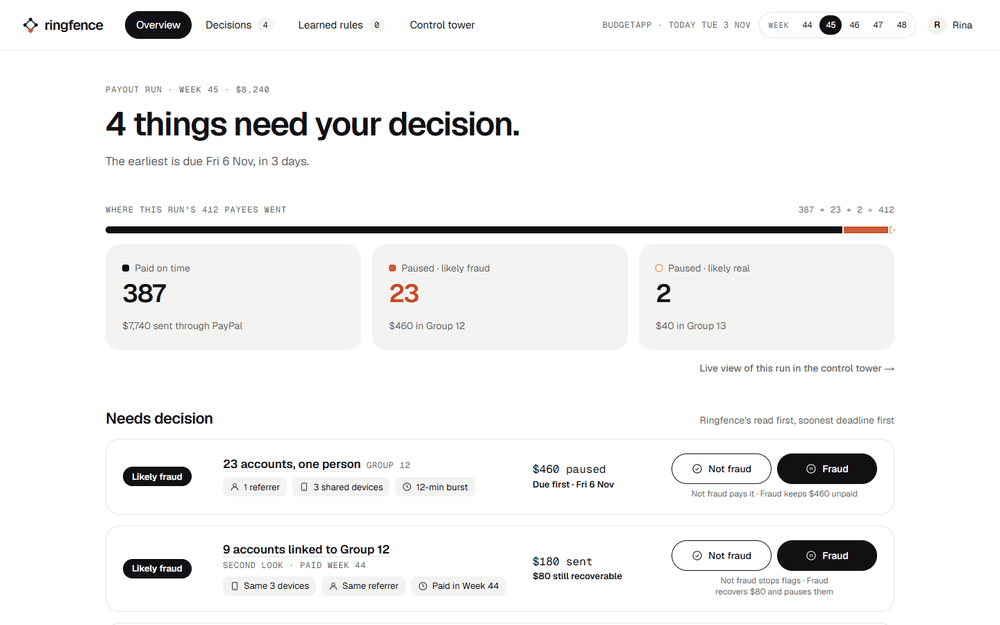
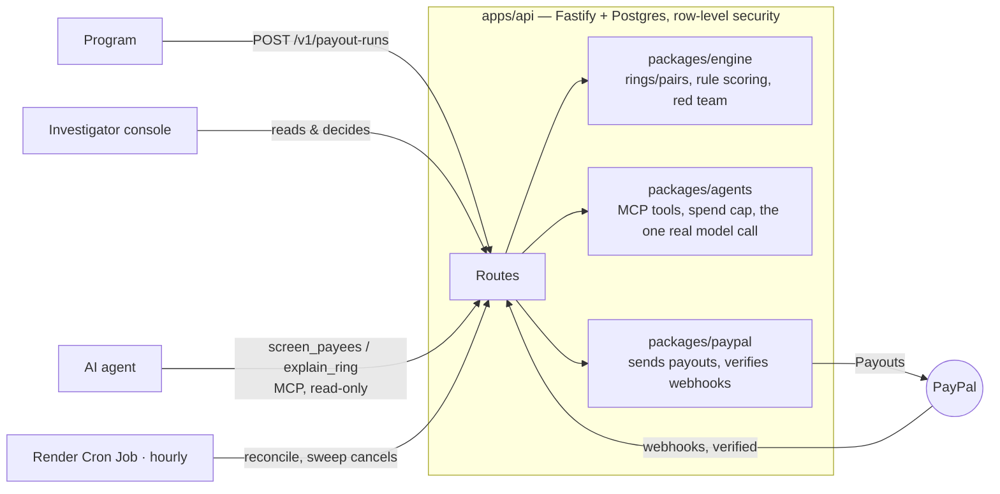
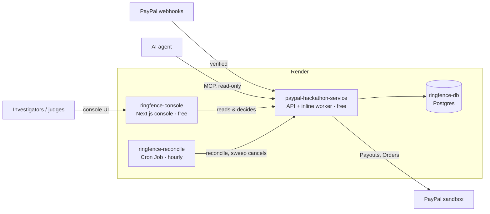

<p align="center">
  
</p>

<p align="center"><b>Pay the real ones. Hold the ring.</b><br/>
A checkpoint a reward program's payouts pass through right before PayPal sends them: it holds the accounts one operator is secretly running, and pays everyone else on time.</p>

<p align="center">
  <a href="https://ringfence-console.onrender.com">Live console</a> ·
  <a href="https://paypal-hackathon-service.onrender.com/health">Live API</a> ·
  <a href="GLOSSARY.md">Glossary</a> ·
  <a href="docs/openapi.yaml">OpenAPI spec</a>
</p>

Built for the **2026 PayPal AI Hackathon**. All money movement runs on **PayPal's sandbox** (test money only).

---

## Try it now

| Option | How |
| --- | --- |
| **Live console** | Open [ringfence-console.onrender.com](https://ringfence-console.onrender.com) — Week 45's run is already loaded: Group 12's 23 linked accounts, paused and waiting for a decision. Step through weeks 44–48 with the stepper in the top bar; nothing you click there reaches the live API or moves real state |
| **Live API** | `curl https://paypal-hackathon-service.onrender.com/health` — free plan, sleeps after 15 idle minutes, so the first hit can take about a minute |
| **Run it locally** | Nothing to install or sign up for first — in-memory database, fake PayPal built in. See [Run it locally](#run-it-locally) |

## The problem

Across reward programs, one person runs a handful of accounts under different names to collect the same bonus repeatedly — same device, same payout address, sign-ups minutes apart. Checking payments one at a time misses the pattern; a blunt rule that catches it risks holding real members by mistake. Ringfence finds the pattern before the batch goes out, holds only the accounts in it, and shows its evidence so a person — not a black box — makes the final call.

## Key terms

Ringfence uses a few words on purpose, consistently, in this doc and in the code. Full list, and the words we deliberately avoid, in [GLOSSARY.md](GLOSSARY.md):

| Term | Plain meaning |
| --- | --- |
| **Ring** | Three or more accounts one person is secretly running, found by shared devices/addresses and sign-up timing |
| **Pair** | Two accounts sharing something like a payout address, each already looking suspicious on its own |
| **Hold** | Paused, not judged — a held payout waits for a person to decide |
| **Release / Confirm** | A person decides a held group is real (it gets paid) or fraud (it's never paid, and recognized automatically from then on) |
| **Learned rule** | A condition Ringfence writes itself after a ring is confirmed, so it can hold similar rings automatically next time |
| **Red team** | Before a new rule goes live, Ringfence attacks it with 200 disguised copies of the ring it came from, to see what it would still miss |
| **MCP** | The protocol that lets an AI agent call Ringfence directly as a tool, instead of a person clicking through the UI |

## What Ringfence does

| Who | Does this | Behind the scenes |
| --- | --- | --- |
| **Program owner** | Sends a PayPal Payouts batch to `POST /v1/payout-runs` | Decides and sends the clear payouts — see [Payout API](#payout-api) |
| **Investigator** | Opens a paused case in **Decisions** | A link graph, sign-up timeline and a checked case file — see [Decisions](#decisions) |
| **Investigator** | Clicks **Fraud** or **Not fraud** | Fraud holds it for good and can write a rule; Not fraud pays it — see [Safety by design](#safety-by-design) |
| **Investigator** | Opens **Learned rules**, flips a proposal **On** | Already red-teamed before anyone sees it — see [Learned rules](#learned-rules) |
| **A held payee** | Taps their own pay link | PayPal's own login, no new account — see [Payout API](#payout-api) |
| **An AI agent** | Calls `screen_payees` over MCP before paying | Read-only — see [Safety by design](#safety-by-design) |
| **Another program** | Confirms a ring as fraud | Recognized elsewhere by a keyed hash, never member data — see [the ring network](#survey-app-and-the-ring-network) |

## Walkthrough



### Overview

The landing screen: this run's split of paid, paused-as-fraud and paused-as-real; everything that still needs a decision, soonest deadline first; and the program's record (money lost, kept, and recovered, plus how often the investigator agreed with Ringfence). A second card surfaces anything another program has recognized through the ring network.

Week 44 starts clean, before Ringfence runs. Week 45 exposes Group 12's 23 linked accounts (the R-12 ring) and the roommate pair. Week 46 reviews Week 45's real outcome and offers R-01-v2, a rule widened against the disguises it missed. Week 47 re-applies whichever rule was accepted against Group 12's return in new disguises. Week 48 folds survey-app's cross-program match — six accounts reusing a Group 12 device — and a simulated unclaimed-payout recovery into the same screens.

### Decisions

Every case Ringfence raises, once: under **To decide** until the investigator acts, then **Decided** with what happened to the money. Opening a case shows a hub-and-spoke graph of how the accounts are linked, a Bryntum-drawn dot plot of their sign-up times, the checked case file, and — for a ring — the rule proposed from it with its red-team score. The member table is AG Grid; the hold calendar (7-day deadlines) and the fire-drill comparison are linked off this screen.

### Learned rules

Every proposed rule is attacked with 200 disguised copies of the ring it came from before anyone sees it: Rule R-01 ("Referral bursts," learned from Group 12) caught 48. The ones it missed are saved as open cases — the next revision widens whichever check a majority of its saved misses would beat, and only a fresh attack that actually catches those exact disguises again closes them: R-01-v2 widens the sign-up window and would close 13 more.

### Control tower

An editable AG Studio dashboard over real data, not a fixed set of widgets: built-in KPI tiles, charts and a group filter sit alongside three custom widgets — the ring diagram (the same picture Decisions draws), a live Ring Watch poll, and a plain-English analyst read. "Edit dashboard" switches Studio into edit mode, where anyone can move, resize, restyle or add a widget by hand — or ask AG Studio's own AI assistant to do it in a sentence ("Add a bar chart of the paused accounts, counted by group"). The assistant needs an OpenRouter key to be offered at all — see [Run it locally](#run-it-locally).

Ring Watch is the one widget that's always live: open the same ring in a second tab and confirm or release the hold there to see it update here.

### Survey app and the ring network

Week 48 folds the survey-app scenario into Overview and Decisions rather than a separate stepper step. Its fixture has 120 payees; six reuse a Group 12 device. A ring confirmed at one program is recognized at another by a keyed hash of its devices and payout addresses, never member data — the on-page live screening control exercises this when the API side is configured. `/survey-app` redirects into the Week 48 Decisions view. The $460 recovery figure is fixture-backed, not a live PayPal cancellation.

## Architecture

How the pieces fit together under the hood — for what you actually see and click, see [Walkthrough](#walkthrough) above.



| Path | What lives there |
| --- | --- |
| `apps/api` | The payout API — hold/pay decisions, PayPal sends, rules, webhooks, MCP server. See [Payout API](#payout-api) |
| `apps/console` | The investigator UI — Overview, Decisions, Learned rules, an editable AG Studio control tower |
| `packages/engine` | Groups accounts into rings and pairs, scores proposed rules, runs the red-team attack |
| `packages/agents` | MCP tools, the hard spending cap, the one real AI model call (a case-file claim → a plain sentence) |
| `packages/paypal` | PayPal sends, webhook verification, "Log in with PayPal" — real sandbox or a built-in fake |
| `packages/sdk` | A generated TypeScript client for Ringfence's own API, plus an agent Context Plugin — see [below](#the-apimatic-context-plugin) |
| `scripts/` | Demo data generation, smoke tests, chaos/fire-drill tests, the real-sandbox week-1 run |
| `docs/` | OpenAPI spec, Postman collection, agent-facing docs, recorded test runs |
| `GLOSSARY.md` | Every term this repo uses on purpose, and the ones it deliberately avoids |

### The APIMatic Context Plugin

We fed Ringfence's own OpenAPI spec ([docs/openapi.yaml](docs/openapi.yaml)) into the APIMatic CLI to generate [packages/sdk](packages/sdk): a real TypeScript client (94 files — auth, pagination, retries, error handling, one model per schema) plus a Context Plugin, a file that teaches a coding agent (Claude Code, Cursor, Codex) how to call that client correctly, in TypeScript, C#, and Python. It's verified, not just generated: `npm install`, `typecheck`, `lint`, and the SDK's own smoke test all pass clean in `packages/sdk`, with 0 vulnerabilities. We also evaluated APIMatic's PayPal-side Context Plugin — the other half of this sponsor's intended use — and found it doesn't cover Payouts, the one PayPal product this build uses, so we generated our own SDK instead.

## Safety by design

- **A hold is a pause, never a verdict.** Only a person's Release or Confirm decides a group's fate; Ringfence never silently blocks a payout.
- **Rules only ever tighten.** No rule — starter or learned — can turn a hold into a payment.
- **Confirmed fraud persists.** A confirmed ring's devices and payout addresses are held, confirmed, on sight in every later run, whatever number that later ring gets.
- **AI agents can't move money.** The MCP server is read-only (`screen_payees`, `explain_ring`); every route that actually sends or releases money refuses the MCP key, even if an agent tries it.
- **The one real model call is capped.** Rewriting a case-file claim into plain English runs under a hard spend cap (`packages/agents`), so a runaway loop can't drain a budget.
- **Per-program isolation, tested as a non-admin role.** `npm test` runs the API on Postgres row-level security as an ordinary database role — the same isolation that applies in production — and rings, pairs and rules are numbered independently per program.
- **Exactly-once sends.** A run's clear payouts go to PayPal as one batch, exactly once; the chaos run kills the process at 5 points mid-run and audits PayPal's ledger for zero duplicates.
- **Forward-only payout states.** A late PayPal event can't move a succeeded payout back to an earlier state.
- **Verified webhooks.** PayPal's status-change notifications are signature-verified before anything is acted on.
- **Secrets never touch the repo.** Render secrets are `sync: false`; the API key, MCP key and admin token are generated by Render, not typed in.

## Payout API

`apps/api` is the service that sits between a program and PayPal. `POST /v1/payout-runs` takes a PayPal Payouts request body (plus optional per-payee context), decides every payee, and sends the paid ones to PayPal as one batch, exactly once. Every `/v1` route takes the program's API key as `Authorization: Bearer <key>`.

**Paid vs. state** — two different things that sound similar: a run's `summary` counts each payout as **paid** (let through and sent on time — set the moment Ringfence lets it through, before PayPal does anything), **held**, or **blocked** (held, confirmed as fraud). "Paid" says nothing about whether the money was actually collected — that's the payout's separate `state`, which follows PayPal's own words once it's sent: **succeeded**, **unclaimed**, **returned**, or **failed** (and before sending: `queued`, `sent`, `held`, `blocked`). A payout can be paid and still sit unclaimed. Full definitions in [GLOSSARY.md](GLOSSARY.md).

| Route | Does |
| --- | --- |
| `POST /v1/payout-runs`, `GET /v1/payout-runs/:id` | Decide and send a run; read back its decisions and PayPal batch |
| `POST /v1/payout-runs/import` | Record a run that was already paid straight through PayPal, so it's tracked and cancellable here too |
| `POST /v1/holds/release` | Pay held payees, or a whole hold group, in a batch of their own |
| `POST /v1/rings/:id/confirm` | Confirm a hold group (a ring `R-12`, a pair `P-01`, or the payouts a learned rule held, `rule:R-07`) as fraud: never pay it, remember its devices and addresses, cancel its earlier unclaimed payouts |
| `GET /v1/rules`, `POST /v1/rules`, `POST /v1/rules/:id/approve` | Propose a rule learned from a confirmed ring, or a revised version of an existing one; Ringfence assigns its number, replays it against past runs, and red-teams it before anyone approves it |
| `POST /v1/screen`, `GET /v1/rings/:id?run_id=` | Preview the decisions a run would get without storing or sending anything; read a held ring's checked case file |
| `POST /v1/webhooks/paypal` | Receives PayPal's own status-change notifications, signature-verified before anything is acted on |
| `POST /mcp` | The MCP server for AI agents: `screen_payees` and `explain_ring`, both read-only |

Import the [Postman collection](docs/postman/Ringfence.postman_collection.json) and [local environment](docs/postman/Ringfence.postman_environment.json) to call the REST API directly; `api_host` defaults to `http://localhost:3000`. [A recorded local run](docs/postman-run.txt) shows 16 passing requests and 17 assertions.

A payee with an individually held payout can prove they own their PayPal address themselves, through `/self-release/start` and `/self-release/callback` — PayPal's own login flow, no new account or password. Ring and pair members, and shared rule holds, can't use this; a person has to decide those.

An agent that pays people out should screen its payees over MCP first, using the program's read-only `RINGFENCE_MCP_KEY`. For example, in Claude Code:

```bash
claude mcp add --transport http ringfence https://<api host>/mcp --header "Authorization: Bearer <mcp key>"
```

`npm run mock-paypal` runs the fake PayPal as its own standalone server, so you can exercise the real PayPal client code and webhook handling without a sandbox account.

## Run it locally

For developing on Ringfence itself — the [live console](https://ringfence-console.onrender.com) already covers trying it. In-memory database, fake PayPal built in, nothing leaves your machine:

```bash
npm install
RINGFENCE_API_KEY=dev-key npm start -w @ringfence/api
```

Then, in another terminal, send it a run:

```bash
curl -X POST localhost:3000/v1/payout-runs \
  -H 'authorization: Bearer dev-key' \
  -H 'content-type: application/json' \
  --data-binary @fixtures/week1.json
```

`.env.example` lists every setting with what it's for; copy it to `.env` and only fill in what the piece you're running needs — the default `PAYPAL_MODE=mock` needs none of the real PayPal or Render settings.

### Also running the console

The same `npm install` above already pulled in AG Grid, AG Studio and Bryntum's trial package for `apps/console`. It runs standalone, on its own seeded fixtures, with no API required — use a different port if the API from above is already on 3000:

```bash
npm run dev -w @ringfence/console -- -p 3001   # http://localhost:3001
```

| Key | Where | For |
| --- | --- | --- |
| `AG_STUDIO` | Trial key from [ag-grid.com/studio](https://www.ag-grid.com/studio/) | Removes the Control tower watermark |
| `GEMINI_API_KEY` | [aistudio.google.com/apikey](https://aistudio.google.com/apikey) | Case-file claims in plain English; falls back to scripted sentences without it |
| `OPENROUTER_API_KEY` | [openrouter.ai](https://openrouter.ai) | The Control tower's AI assistant; the panel just isn't offered without it |

All three are optional — `apps/console/.env.example` has the full list.

**Bryntum's postinstall is gated by npm's script-allowlist** (npm 10.9+): on first install, `npm install-scripts ls` shows what's pending, `npm install-scripts approve <pkg>...` allows it (recorded in `package.json`'s `allowScripts`, already committed here), then `npm rebuild` runs it. Skipping this still installs the package; it just leaves Bryntum's trial-watermarking step unrun.

## Deploying to Render



| Service | Type | Why it exists |
| --- | --- | --- |
| `paypal-hackathon-service` | Web Service, free | The payout API: webhooks, rule engine, MCP server. Kept its original name so its URL and PayPal webhook registration survive redeploys |
| `ringfence-reconcile` | Cron Job, hourly | Reconciles with PayPal and sweeps unclaimed fraud payouts into cancels, so money converges even if a webhook is lost |
| `ringfence-console` | Web Service, free | The investigator console; reads the API's URL and read-only keys straight from that service (`fromService`), never typed twice |
| `ringfence-db` | Postgres | Source of truth for runs, payouts, rings, rules and confirmed fraud |

Every service deploys from the `ringfence` branch — Render's own `main` no longer exists. Both free-plan web services sleep after 15 idle minutes; PayPal retries a webhook that times out, and the hourly cron catches up on its own, so nothing is lost while a service sleeps. Secrets are `sync: false`; the API key, MCP key and admin token are generated by Render, not typed in. [docs/smoke-test-results.md](docs/smoke-test-results.md) records a real PayPal webhook arriving at and verified by the deployed instance — this is genuinely deployed and exercised, not just configured.

1. In Render: **New → Blueprint** → this repo (branch `ringfence`), and enter your PayPal sandbox app's client ID and secret when asked.
2. In the PayPal developer dashboard, register `https://<api host>/v1/webhooks/paypal` for the `PAYMENT.PAYOUTS-ITEM.*` events, then set that webhook's ID as the API's `PAYPAL_WEBHOOK_ID`.
3. Render generates the API key and admin token for you; find them in the API service's Environment tab.
4. On the console service, optionally set `AG_STUDIO`, `GEMINI_API_KEY` and `OPENROUTER_API_KEY` — see [Run it locally](#run-it-locally) for what each does. All three are optional; each feature falls back gracefully without its key.

## Verifying it works

| Command | Checks |
| --- | --- |
| `npm test` | The engine, agents, and API together, with the API running on an in-memory Postgres as an ordinary (non-admin) database role, so the same per-program data isolation applies as in production |
| `npm run smoke` | Day-one smoke tests 1–7 against PayPal's real sandbox (`-- --mock` runs the same tests against the fake instead, to check the script itself) |
| `npm run sandbox:week1` | Week 1 run through the API against the real sandbox: 387 payees in one real batch, the roommate pair released into its own, the ring confirmed, then reconciled. Needs $7,740+ in the sandbox business account |
| `npm run fire-drill` | Compares no gate, a simple per-request gate, and Ringfence, all on one synthetic program — see [docs/fire-drill.md](docs/fire-drill.md) |
| `npm run chaos` | Replays the demo weeks while killing the process at 5 points mid-run, then audits PayPal's ledger for correctness — see [docs/chaos-run.txt](docs/chaos-run.txt) |

## Built with

**Sponsor tools** — PayPal Payouts API (sandbox) · AG Grid + AG Studio (Studio Agent Framework) · Bryntum Scheduler · Render (2 Web Services, Cron Job, Postgres) · APIMatic (generated TypeScript SDK + Context Plugin)

**Everything else** — Next.js 16 · Fastify · Postgres · Model Context Protocol (MCP)
